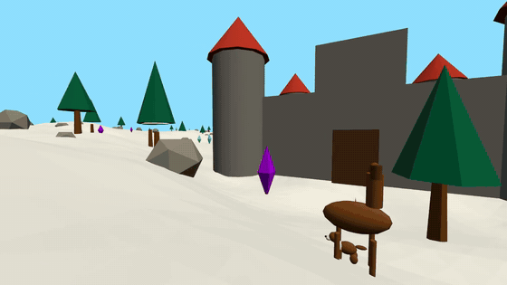
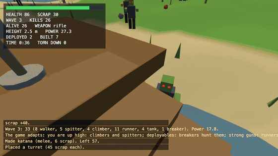
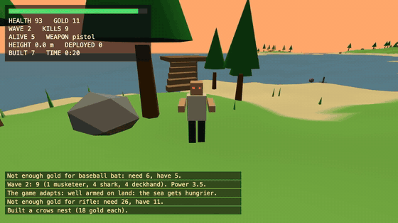
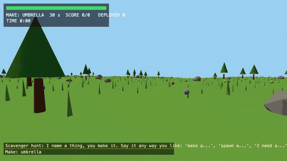

<p align="center"></p>

<h1 align="center">Terraville</h1>

<p align="center"><i>Words in. Worlds out.</i></p>

<p align="center"><b>Say a world. Get a world. In the web page, on your own machine.</b><br>
A 5.86 M-parameter open-world model that runs in plain JavaScript: no server, no GPU, no WASM, no account.</p>

<p align="center">
<a href="LICENSE"></a>


<a href="https://huggingface.co/slm4apps/Terraville"></a>
<a href="https://huggingface.co/spaces/slm4apps/Terraville"></a>
</p>

<p align="center"><a href="https://huggingface.co/spaces/slm4apps/Terraville"></a></p>

```
a snowy island at night with a lighthouse
```

That sentence becomes a 3D world you can walk around, and it keeps changing as you talk: *add three horses*,
*make it cartoon style*, *make it winter*. The model answers with a short spec, a validator checks every field, and a
three.js builder makes the world from it.

## Why

- **Private.** Your words never leave the page.
- **Free to run.** No per-request cost, no key, no account.
- **Small.** 5.86 M parameters, 6.08 MB to download (gzip), model load 20 ms, a typical answer in 191 ms (p50) on one CPU thread.
- **Open.** Apache-2.0 code and weights, trained from scratch (no base model).

## What it understands

Measured on 1,097 test sentences the model never trained on ([full benchmark](models/BENCHMARK.md)):

| | share |
|---|---:|
| rephrased sentences it has not seen (300) | 91.0 % exact |
| sentences like its training set (437) | 94.5 % exact |
| every test sentence (1,097) | 70.3 % exact, 88.6 % of fields right, 99.7 % valid |
| verbs it was never trained on (conjure, whip up, materialize) | 88.9 % of 180 probes |

"Exact" means the whole spec is right. The library holds 1,461 named items in 2,141 designs.

| You type | What happens |
|---|---|
| `a snowy island at night with a lighthouse` | A world: biome, terrain, water, time of day, plants, features |
| `add three horses` | Items from the library are placed in the world |
| `make it cartoon style` | One of 14 styles is applied |
| `make it dusk` | A live change to the world that is already there |
| `whip up a bicycle` | A verb it never saw in training still finds the item |

## Four ways to play it

| Explore: say a world, walk it | Zombies: build up, they adapt |
|---|---|
|  |  |
| **Pirates: hold the island** | **Scavenger hunt: name it, it appears (10/10)** |
|  |  |

*Recorded in the browser from the live model, no edits. A 10-minute session is attached to the GitHub release.*

[Live demo](https://huggingface.co/spaces/slm4apps/Terraville) · [Model card](https://huggingface.co/slm4apps/Terraville) · [Benchmark](models/BENCHMARK.md)

## Run it locally

```bash
git clone https://github.com/slm4apps/terraville && cd terraville
python3 -m http.server 8077        # any static server works
# open http://127.0.0.1:8077/      (Chrome or Edge for voice)
```

Modes: `?mode=free` (the model on its own), `?mode=zombies`, `?mode=pirates`, `?mode=hunt`. Keys: WASD, mouse, Tab (side bar, game modes), V (voice), 1-9 (items).

## How it works

```
words ──> Terraville (5.86 M, int8, plain JS) ──> closed tokens ──> validate() ──> spec (JSON) ──> world builder (three.js)
                                                                                         └──> game runtime (packs/*.json), optional
```

- **The model** (`src/tinylm.js`, weights in `models/`) only ever outputs tokens from a closed vocabulary: biomes, terrain,
  water, time, plants, features, the item library, 14 styles, live-change aspects, tools. `src/spec.js` validates every answer.
- **The world builder** (`src/world.js`, `src/objects.js`, `src/styles.js`) turns a spec into chunks, plants, buildings and items.
- **Use cases on top**: the game runtime (`src/gamekit.js`) knows no game; a pack (`packs/zombies.json`, ...) holds enemies,
  items, resources, rules and what "harder" means, as data. A new game is a new JSON file.

## Repo map

| path | what |
|---|---|
| `src/` | the page: model runtime, validator, world builder, game runtime, voice, recorder |
| `packs/` | game modes as data; `index.json` lists them |
| `models/` | `terraville-tiny.bin` (int8 weights) + `terraville-tiny.json` (manifest), item library, benchmark |
| `data/` | synthetic test and validation sets, generator inputs |
| `docs/` | licensing |
| `tools/` | data generator (`gen_tiny.py`), trainer (`train_tiny.py`), parity, eval, `benchmark.mjs`, probes |
| `tests/` | `npm test`: spec validation; `node tests/tinylm.parity.mjs`: PyTorch <-> JS parity |

## Train your own

```bash
python3 tools/gen_tiny.py                       # synthetic data -> data/tiny/ (96,640 training rows)
python3 tools/train_tiny.py --epochs 8          # PyTorch (CUDA / MPS / CPU); the shipped model took 2,301 s on one Apple-silicon laptop
bash tools/after_train.sh                       # parity, JS eval, models/RESULTS.md
node tools/benchmark.mjs                        # models/BENCHMARK.md
```

Details and settings: [TRAINING.md](TRAINING.md). The item library (`models/library.json`) ships ready-made and the data
generator reads it; the scripts that built it are not part of this repo.

## Limits

- Item names it has never seen as synonyms are matched to the nearest library item, not refused (23.6 % exact on the held-out-synonym split, 70.9 % of fields right).
- The item library is the vocabulary: Terraville builds from 1,461 named items, not arbitrary objects.
- Voice input needs Chrome or Edge.


## Licence

Apache-2.0 for code, docs and model weights ([LICENSE](LICENSE), [NOTICE](NOTICE), [docs/LICENSING.md](docs/LICENSING.md)).
No base model: Terraville is trained from scratch. Bundles three.js (MIT, `LICENSES/MIT-three.js.txt`).
